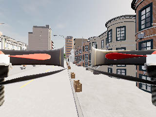

# 本机独立 CARLA/AirSim 联验（2026-10-28）

结论：用户授权使用空闲本机并绕开共享启动流程后，已在完整独立副本中接通真实 CARLA/AirSim API，完成坐标配准、双时钟诊断、限速上升、四轴小动作和命令刷新测试。D2 的独立实例可行性阻塞已解除；D3 已有真实测量，但尚未完成正式 adapter 的时钟/控制闭环接入。D1 独立 town final test 仍缺，前三天不能整体勾选完成。

这是开发诊断，不是目标跟踪实验，不是训练收益、真实 Jev 对照或论文主表。本轮没有读取源 HDF5、训练模型或调用真实 Jev。

## 隔离与复现环境

- 原发行包：`D:/CarlaAir/CarlaAir-v0.1.7-Windows11-x86_64/WindowsNoEditor`，只读复制，不运行其启动器。
- 本任务副本：`D:/JevUavRuns/20261028_d2_probe01/package`。完整复制约 26.001 GiB / 42407 文件，不使用指向原包的目录链接；排除 PDB、Saved 和目录 junction。
- CARLA 端口 3100/3101/3102，AirSim 端口 42451；每次运行创建新的 `runs/<name>`，不覆盖旧结果。
- 实测 CARLA client/server 均为 `7a7fdb3-dirty`，AirSim server version=1，地图 Town02，车辆只有 `JevDrone`。不能用源码 checkout 版本代替发行二进制版本。
- 原包与副本 Shipping SHA-256：`e39091f72c148db0c6821d4dcbbbba55d768fe67e3320707c4007d2db784b0d7`。
- API 客户端：已有 `carlaAir` 环境 Python 3.10.21；控制脚本使用本机较新的 Python（需 3.11+ 的 `hashlib.file_digest`），未安装或修改依赖。
- 设备为 RTX 5070 Ti Laptop / 约 12 GiB 显存、16 GiB RAM。启动前至少 4 GiB 可用 RAM，启动期间低于 768 MiB 则终止本任务；只是 smoke 资源门槛，不是长实验性能保证。

保护范围：比较原包 `CarlaUE4/Config/*` 和真实 MyDocuments 下 `AirSim/settings.json` 的 SHA，最后运行前后全部一致。设置文件及两个解析回落位置都在独立副本内，`--settings` 放在命令最后，通过 `getSettingsString()` 比较完整 JSON，而非仅看端口号。UserDir、Saved、临时目录、普通缓存路径指向任务目录，实际 Saved/config 亦在该目录。Shipping 没生成要求的日志，故不把日志当配置生效证据，也不声称已审计 Windows/显卡驱动所有全局写入。

每轮先查外部 Python/Carla/UE4 进程、相关监听及资源，查询失败不能当作空闲。直接启动复制的 Shipping；引擎和 API 子进程加入同一 kill-on-close Windows Job，并保留原始进程句柄。退出检查监听释放、进程退出、保护文件未变。`Popen` 到 Job assignment 有小窗口，此工具是有界诊断，尚非原子进程创建保护的生产启动器。

最后运行 `contract08` 的所有权、清理及配置检查均通过；收尾再次查询未见 Carla/UE4/Unreal 进程或上述端口监听。没有启动、停止或修改外部采集/上传链。

## 全部运行账目（包括失败）

机器可读结果：[汇总](evidence/isolated_carla_20261028/summary.json)。该目录保存每轮 API 观测及源文件 SHA；原始 owner、pre/postflight、stderr、配置和日志在本机任务根目录。导出将非有限数转成 JSON `null`，源文件哈希保留；不是插值或补测。

| 运行 | 实际内容 | 判定/限制 |
| --- | --- | --- |
| initial_api | 两套 API、车辆/时钟/位置，不解锁 | API 可达；早期只比较设置子集 |
| contract01 | 暂停、无节拍 tick、x 动作、相机 | 发现双时钟不等速及到期后惯性；早期无最终 cleanup 布尔字段 |
| contract02 | 完整 settings、Job 生命周期、有节拍 tick | 独立配置与清理通过；有节拍不等于锁步 |
| contract03 | 动态地标、四轴测量 | 动态物体 AirSim 位姿全部 NaN，配准 **INVALID** |
| contract04 | 改用 12 个共同静态地标 | 配准通过；当时只用 `join()`，未检查动作 RPC 成功返回 |
| contract05 | 动作改为 `get()` 并要求成功 | 起飞阶段拒绝，后续未执行，**FAILED** |
| contract06 | 增加起飞诊断 | 返回 bool False；误将 Vector3r 直接序列化导致 API JSON 缺失，stderr/源哈希保留，**FAILED** |
| contract07 | 显式序列化碰撞字段 | 起飞约 3.4 秒返回 False，实际上升约 1.54 m；不当成功，**FAILED** |
| contract08 | 显式限速垂直 bootstrap，动作检查 RPC 返回 | 上升状态检查、配准、四轴、刷新、相机及收尾完成，是当前有效动作诊断 |

`API_SMOKE_COMPLETED` 只表示执行完成，不是 D3 科学验收或安全证明。旧运行的物理位移仍是观测证据，但不回填未知 RPC 结果。`Future.join()` 仅等待，`get()` 才传播 RPC 错误；现在还要求返回 `True`，拒绝 False/None。

起飞失败原因尚未最终定位。已有 upstream 源码可用于提出路径完成判定的假设，但不能断言该 dirty 二进制有相同 bug。`contract08` 没放宽返回值要求、没自动忽略起飞失败，而是显式选择另一条开发初始化流程：世界 NED `vz=-0.5 m/s` 持续 4 秒，随后零速度 1 秒；必须同时满足 RPC 成功、升高 0.8–3.0 m、水平漂移 <0.5 m、末速 <0.3 m/s、无新增碰撞。实测升高 1.9145 m、水平漂移 0、末速 0.01774 m/s，通过。只在当前开发点验证，不是通用起飞器。

## contract08 实测

### 坐标

12 个共同静态地标覆盖 x/y/z 约 239.5 / 270.88 / 20.0 m，支持现有 `CarlaAirAlignment` 的 x/y 保持、z 反号映射：

```text
AirSim.x = CARLA.x - 108.2799987793
AirSim.y = CARLA.y - 307.8599929810
AirSim.z = -CARLA.z + 4.3100001216
```

各轴偏移极差为 1.53e-5 / 1.91e-5 / 9.54e-7 m；只是 API 数值一致性，不是传感器精度。每个新地图/出生点必须重标定，不能写成全局常量，也不能套用地理 ENU/NED 的 x/y 交换。

动态地标失败解释：AirSim `simListSceneObjects` 可见后来创建的 actor，但 `simGetObjectPose` 使用初始化时构造的 actor map。列得出名字不代表姿态有效；最终使用两 API 都认识的静态 actor，并拒绝非有限位置。

### 时间与命令

| 测项 | CARLA 增量 | AirSim 增量 | 含义 |
| --- | --- | --- | --- |
| 暂停约 0.406 s | 0 s | 0 s | 本实例两时钟都暂停 |
| 20 × 0.05 s 无节拍 tick | 1.000000015 s | 0.3120067 s | 不能用 CARLA 帧数推进 AirSim 预测时域 |
| 20 × 0.05 s 按墙钟节拍 tick | 1.000000015 s | 1.0350220 s | 接近实时但偏差 35 ms，不是锁步 |

live adapter 不能把两时钟固定时差/固定速率当成已证明事实。观测入口需记录各自时间与采样墙钟区间，拒绝过期观测；D6 前决定实时模式或真正可验证的同步模式。离线 HDF 同快照契约不能直接迁移为 live 同步保证。

四轴均为 1 秒请求，随后显式零速度 1 秒。下表位移跨越“动作加刹车”的遥测窗口，**不是**纯 1 秒速度积分，不用于训练标签：

| 指令 | RPC 完成耗时 | 对应轴位移/角度（含刹车） |
| --- | --- | --- |
| vx=+0.3 m/s | 1.016 s | dx=+0.30544 m |
| vy=+0.3 m/s | 1.016 s | dy=+0.24806 m |
| vz=-0.3 m/s | 1.015 s | dz=-0.30086 m |
| yaw rate=+15 deg/s | 1.016 s | dyaw=+0.26261 rad，约 15.05 deg |

遥测实测约 16.13–16.62 Hz，不能称为 20 Hz 观测。非主轴仍有上一动作残余漂移，零速度 1 秒不保证静止；正式成对实验必须检查稳态和重置误差。

独立 1 秒刷新诊断：50 ms 绝对时隙，每条速度请求至多 40 ms，等待该 RPC 确认；过期时隙跳过，不积压追发。20 条发送、20 条成功确认、0 个跳过，平均发送频率 **19.871 Hz**，最大间隔 62.56 ms，最大确认延迟 42.49 ms；在 1.00548 s 发显式刹车。只证明短时间客户端 RPC 刷新，不是飞控内部频率、硬实时保证或带感知/Jev 负载的闭环。

动作测试阶段无新增碰撞。初始化曾有路面接触，不能报告“从启动到结束从未碰撞”。未统计障碍最小间距、近失率、目标身份或重捕获时间。

### 图像

取得真实 320×240 RGB PNG，但当前前视图含机臂/旋翼遮挡；像素可读不等于感知输入已适用。下一项需要在本任务设置内调整相机安装并验证外参/可见性，没有伪装成目标跟踪视频。



## 复现与测试

prepare 仅做一次，约需 40 GiB 可用磁盘；已有根目录不能重复 prepare，也不能删证据重用名字。以下为新任务/新运行示例，启动前仍执行占用检查：

```powershell
$env:PYTHONPATH = (Resolve-Path src).Path
python scripts/probe_isolated_carla.py prepare --source D:/CarlaAir/CarlaAir-v0.1.7-Windows11-x86_64/WindowsNoEditor --task D:/JevUavRuns/new_owned_probe
python scripts/probe_isolated_carla.py smoke --source D:/CarlaAir/CarlaAir-v0.1.7-Windows11-x86_64/WindowsNoEditor --task D:/JevUavRuns/new_owned_probe --client-python C:/Users/20748/miniconda3/envs/carlaAir/python.exe --run-name contract01 --profile contract --bootstrap velocity
python scripts/summarize_carla_probe.py --root D:/JevUavRuns/new_owned_probe --output artifacts/new_owned_probe_summary
```

本机已有副本无需再复制；task 改为 `D:/JevUavRuns/20261028_d2_probe01`，用未存在的 run-name 即可。默认 `--bootstrap takeoff` 会严格保留当前起飞失败，velocity 必须显式选择。控制脚本仅 Windows 可用。

```powershell
python -m pytest -q
python -m compileall -q scripts src
git diff --check
```

验证：**145 tests passed**，编译及 diff 检查通过。新增回归覆盖根目录隔离、settings/输出路径、真实 Job 清理、PowerShell 错误拒绝、RPC 错误/False 拒绝、慢调用不追发及失败刹车、无效坐标/缺测汇总。依据 requesting-code-review 进行只读审查，按 verification-before-completion 检查；返回值问题按 systematic-debugging 保留失败并增加诊断。

## 验收与下一关键切片

| 项目 | 当前判定 | 剩余 |
| --- | --- | --- |
| D1 | 部分通过 | 未参与开发的独立 town PASS final test；39 开发 episode 不改名充数 |
| D2 | 有界独立实例可行性通过 | 长时间/带感知负载尚未验证，资源须每次重查；真实 Jev 历史账本 UNKNOWN |
| D3 | 离线通过，真实契约联验部分通过 | 标准 takeoff False 原因；live 双时钟/过期门控接入；稳定观测周期和相机外参 |
| 跟踪与论文 | 无本轮新增效果结论 | 共享感知/控制器的成对闭环，以及独立测试和消融 |

下一切片直接接仿真执行链：任务内相机外参 → 带时间边界的观测 adapter → 限速/过期保护的低层执行 → 单个 development 目标的 utility 控制诊断。先证明接口与可见性，再加入 residual / Mock / real Jev；真实 Jev 仍受既有 8/32 与账本门控，不因仿真接通扩大预算。原始失败和负结果均保留。
