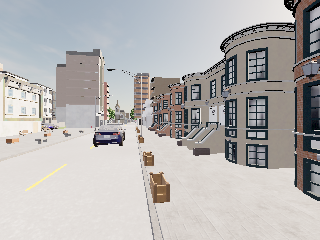
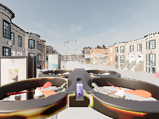

# D3：真实可见目标输入、因果 belief 与安全拒绝（2026-10-28）

## 结果与边界

在本任务独立 Town02 实例中，接通了 **真实相机/可见性诊断 → 当前可见目标位置 → 因果 TargetBelief → 8帧历史 → 8个候选 rollout → 硬安全过滤**。16帧全部通过时间门控：前4帧可见，中间4帧相机转向后目标出框，后8帧恢复可见。目标位置只查询12次，正好对应12个可见帧，丢失期间当前身份为null、置信度为0。

**这不是视觉模型或跟踪效果实验。** 输入来自仿真器可见性判定及可见时的位置真值，明确标记 `simulator_visible_oracle`；不是RGB检测、ReID、真实遮挡或身份交叉数据。没有执行模型选择的动作，也没有训练或真实Jev请求。

本轮没有可信的障碍间距和电量百分比输入，适配器明确将缺失值转成保守的0并标注原因，不继承样例默认的10m/100%。因此Mock/utility两条选择流程都在客户端调用前被硬门控拒绝：**32次安全拒绝，0次动作选择/执行**。这不能作为Mock优于utility或Jev增益的对照结果。

## 输入协议

- `LiveBeliefAdapter` 将vehicle-local NED通过本实例原点桥接转成CARLA world-z-up；速度只翻转z，不加平移。
- 图像、可见性查询、可见目标位置查询都放在AirSim state与CARLA snapshot前后读取的时间区间内。检测接口没有独立时间戳，记录为null；只证明有界RPC采样区间，不声称像素曝光/检测/位姿完全同时。
- 先经原150ms读取、200ms过期、跨域时钟和单调性门控，再建立belief。目标速度仅用过去可见位置后向差分，未调用目标速度/未来轨迹API。
- 目标不可见时根本不查询位置；外推只使用已保存历史。当前actor id设为null、identity confidence设为0，旧身份可保留在历史中，不能冒充当前观测。
- 有效历史最多8帧；无效输入不提交estimator/history。范围、像素中心、有限数、安全值和身份字段有回归检查。
- 该模块不拥有连接或动作执行函数。测试中的完整安全值是合成接口fixture，不是本次现场测量。

## 实验设置与全部尝试

沿用独立副本、原4GiB启动门槛、专属端口3100/42451和共享配置SHA保护，不运行共享启动器。只在本任务实例创建一辆 `vehicle.tesla.model3`，放在前方道路waypoint上方0.8m，关闭该测试车物理以保持静止；这是静态输入诊断，不能代表车辆动力学。通过生成前后对象清单确认新Tesla pawn及伴生controller，不借用原有actor。结束删除本次actor，再退出所属实例。

| 尝试 | 结果 | 保留的证据 |
| --- | --- | --- |
| belief01 | FAILED，目标识别阶段 | 生成车辆同时出现pawn和AI controller，最初“只能有一个新对象”的条件拒绝；目标已删除，保护配置及清理通过 |
| belief02 | 启动前拒绝 | 可用内存4,112,764 KiB低于4GiB，未启动引擎；仅preflight，导出明确记INCOMPLETE_CONTROLLER_RECORD |
| belief03 | 输入/安全拒绝诊断完成 | 16/16帧接纳，可见→出框→恢复；目标删除、保护配置及所属进程/监听清理通过 |

完整[机器可读汇总](evidence/live_belief_20261028/summary.json)按 `belief` 前缀导出，含失败和preflight-only记录。运行时脚本及10个相关模块SHA随证据保存。没有读取/改写原trimmed HDF5；这些JSON/PNG是开发诊断，不自动认定为新的PASS episode或独立test。

## belief03 实测

| 测项 | 结果 |
| --- | --- |
| 接纳观测 | 16/16 |
| 可见/缺失 | 12/4；索引0–3可见、4–7缺失、8–15恢复 |
| 目标位置查询 | 12；缺失帧0次 |
| 读取耗时 | 平均34.705ms，最大77.048ms |
| 起始读取频率 | 5.020Hz，3秒短诊断；不是20Hz闭环控制证明 |
| rollout候选 | 16×8=128；均为透明运动学预测，非真实执行后果 |
| 两条选择流程 | 16×2=32次SAFETY_REJECTED，客户端choose未调用 |
| belief阶段模型动作 | 0；前置诊断仍包含已记录的bootstrap/四轴动作 |
| belief阶段新增碰撞 | 无；不抹去初始化路面接触历史 |

缺失阶段协方差从0.05随历史外推年龄增大，恢复可见后回到0.05；这是估计器规则响应，不是校准精度或重捕获指标。已知actor的oracle身份不能用于宣称身份保持率。

### 实际画面

前视可见测试车辆：



相机转向180°后目标出框；图中自身机臂/旋翼可见，不能声称后视无遮挡或真实遮挡实验：



恢复前视后目标再次可见：


## 不启动仿真的严格复核

`check_live_belief_evidence.py`检查完整16帧顺序、缺失数据隔离、8帧历史、生命周期、查询数，重建全部belief、128个候选与32次拒绝。不是只找到一个可见帧就判通过。

```powershell
$env:PYTHONPATH=(Resolve-Path src).Path
& C:/Users/20748/miniconda3/envs/carlaAir/python.exe scripts/check_live_belief_evidence.py --evidence docs/experiments/evidence/live_belief_20261028/belief03.json
python -m pytest -q
python -m compileall -q scripts src
git diff --check
```

原Python3.10.21客户端环境严格文本重放 **PASS**，见 [严格复核](evidence/live_belief_20261028/reproduction_v2.json)。浮点数比较仅容许1e-12绝对/相对舍入误差；离散身份、布尔和文本不据此放宽。

本机Python3.14.7曾出现约1.8e-15的range-error差异，以及帧7–9的history summary `visible_mean=0.53`与原`0.52`不一致；默认严格复核会拒绝。显式加 `--allow-text-differences` 仅作诊断，输出 [NUMERIC_ONLY_TEXT_MISMATCH](evidence/live_belief_20261028/reproduction_cross_runtime_v2.json)，保留每条字符串差异，**不标PASS**。正式对照必须固定同一运行环境；不能假设实际Jev对不同文本给相同答案。

本轮 **205 tests passed**，包括真实记录重放及截断序列、隐藏位置、篡改belief/候选、错误清理、额外查询、1e-6数值错误、NaN的拒绝测试。没有因复核而修改历史测量或共享Python环境。

只读审查发现离线验证器最初可能把近似整数的浮点actor id当作相同身份；已先复现再修正为整数类型和值都必须一致。最新复核文件使用v2后缀，先前两份复核文件保留为历史，不能拿其旧验证器SHA当最新版。

## 重新运行独立现场诊断

run-name与导出目录必须全新；启动仍需当下资源/所有权检查。

```powershell
$env:PYTHONPATH=(Resolve-Path src).Path
python scripts/probe_isolated_carla.py smoke --source D:/CarlaAir/CarlaAir-v0.1.7-Windows11-x86_64/WindowsNoEditor --task D:/JevUavRuns/20261028_d2_probe01 --client-python C:/Users/20748/miniconda3/envs/carlaAir/python.exe --run-name belief04 --profile belief --bootstrap velocity
python scripts/summarize_carla_probe.py --root D:/JevUavRuns/20261028_d2_probe01 --output artifacts/live_belief_reproduction --run-prefix belief
```

## 未完成项

D1未使用的独立town final test仍缺。D3已从纯图像读数推进到真实可见oracle测量、因果估计和候选/安全过滤，但安全输入、完整选行动作和统一负载下的执行闭环仍未验收；标准takeoff False与非锁步限制保留。下一步需要补实际安全上下文和受限动作执行，之后才有资格比较重捕获、身份保持与安全事件。整体目标保持未完成。
