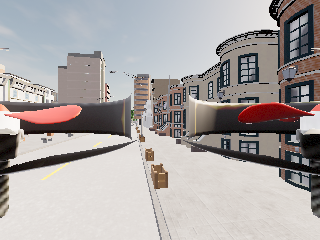
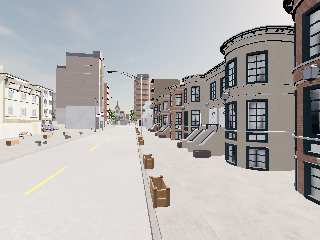

# D3：真实观测时间门控与相机外参（2026-10-28）

本轮接上了真实图像/状态读取与动作分发的时间门控：12/12 次读取通过，基于新鲜观测的一条限速短动作收到 RPC 成功确认；故意延迟的动作在运动 RPC 前被拒绝。相机前移后，目视图像中已无自身机臂/旋翼遮挡，位置和朝向均经接口数值核验。

仍是开发契约联验，没有目标检测/跟踪、Jev 选择、训练或效果对照。它不是带感知和模型负载的 20 Hz 跟踪控制器。旧 HDF5 和原采集/上传链未访问或修改，API key 未读取，真实 Jev 请求为 0。

## 两次运行与失败保留

同一已验证独立副本 `D:/JevUavRuns/20261028_d2_probe01`，沿用专属端口、完整 settings 比对、Job 进程所有权及配置 SHA 保护；每次全新运行目录。主流程仍使用显式 `--bootstrap velocity`，未将之前 `takeoff=False` 改写为成功。

| 运行 | 结果 | 原因/证据 |
| --- | --- | --- |
| observation01 | FAILED | AirSim SDK 的 `Quaternionr.inverse()` 使用 NumPy 2 已删除的 `np.sctypes`，在相机数学计算处失败；未进行后续观测分发实验 |
| observation02 | API_SMOKE_COMPLETED | 仓库内纯数学四元数计算替代该调用；相机位置/朝向、12 次时间检查、新鲜动作、过期拒绝、退出清理通过 |

没有降级/修改共享 Python 环境。SDK 失败保留在 [全部 observation-profile 证据](evidence/live_observation_20261028/summary.json)，按预先明确的 profile 导出所有成功/失败运行，不按结果挑选。原始 API JSON、stderr、进程及启动证据仍在本机任务目录；公开导出包含原文件与本轮脚本/门控/坐标模块的 SHA。

两轮 `protected_unchanged=true`、`cleanup_confirmed=true`；收尾查询无 Carla/UE4/Unreal 进程或相关端口监听。完整隔离边界及启动方式见 [上一轮报告](isolated_carla_smoke_20261028.md)。

## 时间与动作契约

`CaptureWindow` 保存读取开始/结束的 `perf_counter()`、图像前后 AirSim state 时间、图像时间、读取前后 CARLA elapsed time/frame。CARLA 与 AirSim 保留独立时钟域，不声称它们同速或固定时差；像素曝光时间和 renderer 内部 pose 同步也未作保证。

`TemporalObservationGate` 的开发门槛在现场运行前固定：

- 整次读取不超过 150 ms；决策有效期从读取请求开始算 200 ms。
- 图像须位于同域 AirSim state 时间括号内，最多容许 5 ms 数值/采样偏差；拒绝非有限值、倒退、暂停及重复帧。
- 用两个时钟的采集区间保存偏移范围；相对首个有效区间偏离超过 100 ms 则拒绝。不拟合一个看似精确的全局时差。
- 新读取被拒绝时撤销旧观测的动作授权，但保留历史/校准状态供下次合法读取检查。
- 只有最新接纳的观测对象可分发一次；即使 RPC 结果不确定，也不重放同一包。
- 本开发入口限制速度 ≤0.3 m/s、yaw rate ≤15 deg/s、单次请求 ≤100 ms；分发前再查过期，并裁剪请求时长。调用方负责显式刹车和进程收尾。

这是客户端请求门控，不能保证服务器执行/网络延迟/物理刹停严格受同一 deadline 限制，也不替代障碍地图和完整安全控制器。

### observation02 的实际结果

| 检查 | 实测 |
| --- | --- |
| 预设 5 Hz 的图像/状态采样 | 12 次，实测约 4.986 Hz，全部接纳 |
| 整次读取耗时 | 平均 19.13 ms，最大 29.17 ms |
| 图像到后读 AirSim state 的同域差 | 最大 6.00 ms |
| 新鲜观测到动作发送 | 从请求开始计约 12.48 ms |
| 新鲜动作 | vx=0.1 m/s、请求 50 ms；RPC True，确认耗时约 61.41 ms，随后显式零速 0.5 s |
| 故意延迟的动作 | 从请求开始计 272.11 ms，报 `Observation expired before dispatch`，没有新增非零运动 RPC |
| 本观测测试阶段新增碰撞 | false；不是启动全程无碰撞或近失率证明 |

12 帧观测和 20 Hz 客户端刷新是两个不同测试，不能把它们拼成“感知/Jev/控制全链路 20 Hz 已通过”。目前新鲜动作来自固定诊断指令，尚未来自 TargetBelief/rollout/selector。

## 相机外参和图像

本任务内 `simSetCameraPose` 将相机移到机体 FRD `(0.75, 0, -0.20) m`，相对姿态为单位四元数；没有更改原包或用户 settings。冻结场景后，按车辆完整四元数计算相机世界 NED 位置，并比较图像返回的位置与朝向。纯数学实现处理 roll/pitch/yaw 和 q/-q 等价，非法四元数拒绝。

预设验收为位置误差 <2 cm 且角误差 <1°，实测 **0.000534 m / 0.001737°**。这是已知安装变换与 API 返回的一致性，不是物理测量精度。只验证当前开发姿态，尚非覆盖全 yaw/pitch/roll 组合的动态外参标定。

调整前：



调整后：



原始 JSON 的 `visual_clearance=REQUIRES_IMAGE_REVIEW` 保持不改。本报告记录事后目视检查：第二张图不再出现自身机臂/旋翼；尚未量化所有姿态下的遮挡覆盖率，亦未评价目标检测能力。

## 验证与复现

```powershell
$env:PYTHONPATH = (Resolve-Path src).Path
python -m pytest -q
python -m compileall -q scripts src
python scripts/probe_isolated_carla.py smoke --source D:/CarlaAir/CarlaAir-v0.1.7-Windows11-x86_64/WindowsNoEditor --task D:/JevUavRuns/20261028_d2_probe01 --client-python C:/Users/20748/miniconda3/envs/carlaAir/python.exe --run-name observation03 --profile observation --bootstrap velocity
python scripts/summarize_carla_probe.py --root D:/JevUavRuns/20261028_d2_probe01 --profile observation --output artifacts/live_observation_reproduction
```

使用未存在的 run-name/output，不能覆盖或删除失败证据。上一轮已准备副本，无需再复制；启动仍需通过当前进程/端口/资源检查。

**167 tests passed**，compileall/diff 检查通过。新增17个时间/分发回归、4个相机四元数回归、1个失败运行不被 profile 导出丢掉的回归；TDD 中旧授权未撤销曾复现失败并修复。只读审查指出只验位置不足，现已保存并核对完整朝向；没有把 SDK 错误当成外部资源阻塞而搁置。

## D1–D3 当前缺口

D2 独立实例可行性保持通过。本轮进一步补上 D3 真实图像采集时间检查、相机外参和动作过期拒绝；时间/坐标/时域/因果输入的已有离线检查也保留。

仍未把这些读取接到正式 TargetBelief/rollout/selector，也没有统一负载下的控制周期验证；因此不将本诊断标为整条 D3/闭环验收完成。D1 独立 town final test 仍缺，标准 takeoff False 原因未解决。下一步沿同一隔离实例接可见测量到因果 belief，保留隐藏真值仅作评估，再做最小 utility 跟踪诊断；真实 Jev 仍受原有预算/账本门控。
